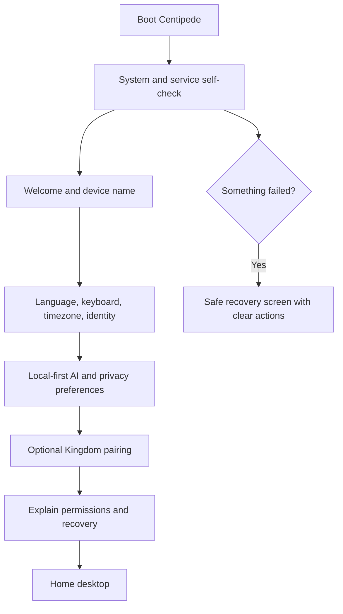
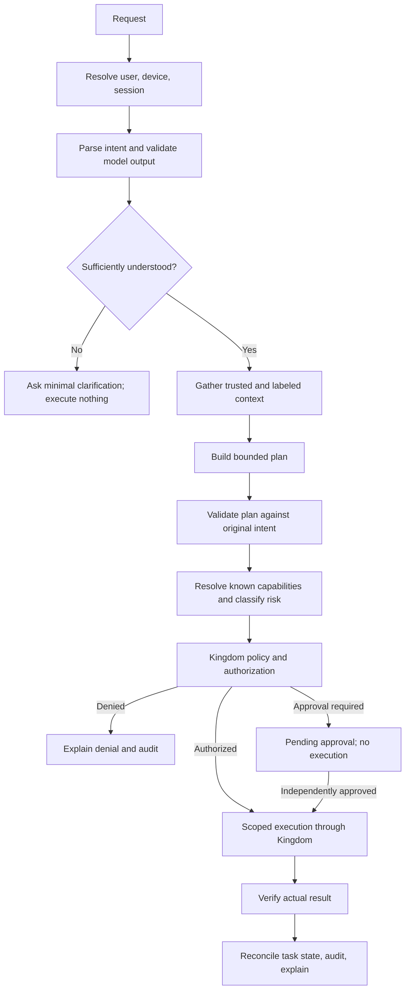

# Centipede OS — Master Product, Architecture, UX & Release Specification

> **Project:** [wests-cmd/Centipede-os](https://github.com/wests-cmd/Centipede-os)  
> **Related runtime:** [wests-cmd/kingdom](https://github.com/wests-cmd/kingdom)  
> **Document type:** Living engineering and product specification  
> **Compiled from:** Centipede OS project documents supplied in this conversation, November 22, 2026  
> **Purpose:** Define what Centipede OS is, what it must become, how the parts interact, what counts as *actually working*, and what blocks release.

**Evidence warning:** This is a consolidated specification, **not a fresh inspection or certification of the GitHub repository or installed machines**. Historical test reports and status descriptions below are labeled as such. An implementation must not be marked complete until the exact current commit and released artifact are tested. Where this document says **must** or **target**, it describes a product requirement—not proof that the feature exists today.

---

## 1. Executive definition

**Centipede OS** is a lightweight, AI-first, Linux-based operating environment intended to be usable as a normal computer and as the human-facing command center for **Kingdom**, a distributed, permission-controlled runtime. Its assistant, **Segmentor**, helps users understand, organize, search, automate, troubleshoot, and operate their computers through natural language, voice, and direct graphical controls.

The user should be able to download Centipede, install it without a terminal, open familiar apps, work offline where possible, securely connect other devices, and ask Segmentor to complete useful tasks. The same operations must be visible and controllable through the desktop interface without requiring the AI.

Centipede is **not** meant to replace Linux's kernel, driver ecosystem, or hardware infrastructure. Its OS/distribution targets build on Debian/Linux. A React/Bun desktop packaged into a Debian image is an operating environment built on Linux—not an independently implemented kernel. The product should describe itself precisely.

### The product's defining rule

> **The user owns the machine. Segmentor can propose actions. Kingdom and the verified security/tool layer independently authorize and execute privileged actions. Successful execution must be verified, not assumed.**

```text
USER
  |
  v
CENTIPEDE DESKTOP / APPLICATIONS / MOBILE COMPANION
  |
  v
SEGMENTOR — understand, retrieve context, plan, explain
  |
  v
CONTROL PLANE — validate plan, resolve capability, evaluate risk
  |
  v
KINGDOM — identity, policy, authorization, approvals, runtime
  |
  v
TRUSTED WORKER / VERIFIED SKILL / RESTRICTED OS CAPABILITY
  |
  v
VERIFICATION + AUDIT + RECONCILIATION
  |
  v
USER-VISIBLE RESULT
```

**Never:** `model -> unrestricted shell`, `model -> root filesystem`, `model -> Docker socket`, `model -> security approval`, or `model -> persistent privilege expansion`.

---

## 2. Who Centipede is for

| User | Expected experience | Advanced detail should be… |
|---|---|---|
| Everyday user | Boot, browse, manage files, connect Wi-Fi, launch apps, ask Segmentor questions, update and recover | Hidden by default |
| Power user | Skills, workflows, task history, model selection, search, memory, pairing, permissions | Accessible on demand |
| Owner/administrator | Kingdom workers, policy, node trust, audits, updates, diagnostics, recovery | Explicitly authenticated and permission-controlled |
| Developer/operator | Source, logs, schemas, API contracts, reproducible builds, CI evidence, adversarial tests | Available without complicating the main desktop |

**Daily-driver definition:** a new user can install Centipede, complete ordinary computer tasks, connect peripherals, save data, update, restart, recover and understand failures without opening a terminal or reading source code.

---

## 3. Project status: historical evidence vs release requirements

The supplied project materials represent work and assessments from different stages. Earlier material describes a **desktop web bundle with a planned bootable ISO**; a later supplied status report describes **Debian ISO/USB/VM and Docker build jobs passing**. Those statements are not necessarily contradictory: a build job passing is not proof that a physical installation, permanent boot, upgrade/rollback, or daily-driver acceptance test passed.

### Current live repository verification (November 22, 2026)

The following facts were checked directly against GitHub in the current work session. They supersede historical states below **only for the specific objects checked**; they do not certify runtime behavior on physical machines.

| Object checked | Evidence-based current state | Limitation |
|---|---|---|
| Repository `main` | `173ac838f2a2ff04a2b1f5cecfef25ec1698150b` | Branch may advance; record SHA for each release or validation |
| Current package version | `1.0.1` in `package.json` | Source version is not evidence of a stable GA release |
| Published preview | [`v1.0.1-rc.11`](https://github.com/wests-cmd/Centipede-os/releases/tag/v1.0.1-rc.11), published November 22 | Experimental prerelease, not a certified installed daily-driver OS |
| RC11 tagged source | `63b4b63d7af104cb456a86530e43d16e8b5a699d` | Tag is older than current `main`, so later changes are not in these published assets |
| Published preview assets | GitHub Release API lists desktop web bundle, Debian ISO/live USB, QEMU QCOW2, Docker tar, SHA256SUMS and release manifest | Asset listing does not establish physical-machine acceptance or permanent installation |
| Mobile targets | Android and iOS `BLOCKED` in `release/targets.json` | No supported signed RC11 APK/IPA |
| PR #161 / #162 | Both merged | Their former open states in historical reports are obsolete |
| Open work | [#163](https://github.com/wests-cmd/Centipede-os/pull/163) release-source validation; [#165](https://github.com/wests-cmd/Centipede-os/pull/165) update metadata; [#171](https://github.com/wests-cmd/Centipede-os/pull/171) desktop window fit; [#175](https://github.com/wests-cmd/Centipede-os/pull/175) background worker | Do not merge based only on PR descriptions; verify checks, changes and merge compatibility |
| `main` branch protection | GitHub branch metadata currently reports `protected: false` | Governance improvement still required |
| Release-readiness issue | [#150](https://github.com/wests-cmd/Centipede-os/issues/150) remains open | Physical and permanent-install acceptance not certified |

**Source links:** [current main](https://github.com/wests-cmd/Centipede-os/commit/173ac838f2a2ff04a2b1f5cecfef25ec1698150b), [RC11 release](https://github.com/wests-cmd/Centipede-os/releases/tag/v1.0.1-rc.11), [beginner downloads](../DOWNLOADS.md), [published asset inventory](../release/published-preview.json). Information is a dated snapshot; before any future build/release, re-query the relevant objects.

### Historical latest status snapshot found in the supplied material

The document `centipede-os.txt` reports the following at its time of writing:

| Item | Reported finding | What still needs verification |
|---|---|---|
| `main` | Commit `563893a7993d6208a89185262e116b0bde868bc6` | Check whether this is still the current head |
| Stable-tag release | **Failed** | Re-run on an exact recorded revision, review all required gates |
| Desktop packaging | Build-generated files caused the release builder's dirty-tree check to reject the package | Separate immutable source checks from generated outputs without weakening release integrity |
| Android signing | Signing certificate did **not** match the pinned publisher fingerprint | Restore correct key/certificate provenance; never bypass fingerprint validation |
| Debian ISO/USB/VM job | **Reported pass** | Boot in a VM and on target hardware; verify installer and persistence |
| Docker job | **Reported pass** | Verify container runs its actual services and joins Kingdom correctly |
| Permanent installation + rollback | Not verified | Test complete install/reboot/update/recovery on physical disks |
| Physical daily-driver readiness | Not verified | Run hardware-specific acceptance on low-end machine and DT1 |
| Protected `main` | Reported unprotected | Verify current branch rules and enforce appropriate gates |
| PR #161 | Release-gate improvement reported open and passing its exact-head checks | Check current PR state, integration and merge safety |
| PR #162 | Physical acceptance/evidence improvement reported open and passing its exact-head checks | Check current PR state, integration and merge safety |

**Historical reference links:** [release workflow run](https://github.com/wests-cmd/Centipede-os/actions/runs/44928045615), [platform build results](https://github.com/wests-cmd/Centipede-os/actions/runs/44928045647), [readiness issue #150](https://github.com/wests-cmd/Centipede-os/issues/150), [PR #161](https://github.com/wests-cmd/Centipede-os/pull/161), [PR #162](https://github.com/wests-cmd/Centipede-os/pull/162). Links identify evidence cited in the supplied report, not independent revalidation performed for this document.

### Status vocabulary (mandatory)

Use **PROVEN**, **PARTIAL**, **PLANNED**, **SIMULATED**, **UNAVAILABLE**, **BLOCKED**, and **UNKNOWN** in release and feature reports. Use separate runtime states such as **CONNECTED**, **DEGRADED**, **OFFLINE**, **DENIED**, **PENDING_APPROVAL**, **FAILED**, and **VERIFIED**. Never turn a demo, mock, green compile, or successful API response into a claim of actual OS behavior.

A component is **PROVEN** only when its current source, actual runtime execution, automated checks, and—when needed—physical/device acceptance support that claim.

---

## 4. Product boundaries and responsibilities

| Layer | Owns | Must not own |
|---|---|---|
| Debian/Linux | Kernel, drivers, hardware, networking, users, disk, boot, process management | Segmentor's planning or user-facing workflow decisions |
| Centipede shell | Windows, menus, navigation, files UI, settings, notifications, human-facing status | Privileged security authority |
| Segmentor | Intent, conversation, context, plans, explanations, model choice | Granting its own permissions or executing raw privileged commands |
| Centipede control/adapters | Schema validation, capability mapping, request correlation, presentation of approval state | A competing Kingdom policy database or unbounded execution layer |
| Kingdom | Distributed runtime, task/worker authority, identity, policies, approvals, execution authorization, canonical task status | The whole desktop user experience |
| Knights/workers | Actual authorized work in constrained execution environments | Permanent self-granted broad host privileges |
| Skills/workflows | Reusable operations and orchestrated plans | Independent authority or inherited unrestricted privileges |
| Mobile companion | Remote views, scoped requests, approvals, vault uploads | Bypassing pairing, revocation, or Kingdom checks |

**Dependency direction:** `Centipede UI -> typed local service/adapters -> Kingdom contract -> authorized worker`. Do not duplicate the existing Kingdom scheduler, node registry, memory backend or approval authority inside Centipede.

---

## 5. Target runtime and deployment architecture

```text
BOOTLOADER / DEBIAN BASE
  ├─ display, input, sound, network, power, storage, drivers
  ├─ systemd-managed local services (least privilege)
  ├─ Centipede graphical shell
  │    ├─ Home / Segmentor / Apps / Files / Tasks
  │    ├─ Devices / Skills / Workflows / Memory / Search
  │    └─ Settings / Security / Health / Updates / Recovery
  ├─ Centipede local API / trusted OS bridges
  ├─ Kingdom adapter, protocol/version negotiation
  ├─ optional local model runtime (Ollama/llama.cpp class adapters)
  └─ Kingdom (local or remote)
         ├─ control plane / approval service
         ├─ Knights / additional devices
         └─ restricted tools / skill execution / audit
```

### Deployment profiles (product targets, not currently certified downloads)

| Profile | Purpose | User experience | Release gate |
|---|---|---|---|
| Full desktop install | Daily-driver computer | Graphical installer, persistent disk, native desktop | Real hardware boot, safe installation, restart and rollback |
| Live USB | Try without writing to disk | Boot from USB; explicit separate Install action | Data remains unchanged unless user authorizes install |
| Ultralight | Older/low-RAM computers | Small footprint, reduced motion, optional models | End-to-end test on ~4 GB RAM/dual-core CPU; **target artifact under 5 GB** where feasible |
| VM image | Safe trial and compatibility tests | Import, boot, first-run wizard | Tested on declared hypervisors, working network and display |
| Docker | Runtime/workers/test deployment | Documented image and scoped services; **not a substitute for a desktop installer** | Actual service health and Kingdom task round-trip |
| Desktop application | Optional host-OS shell/client | Installer or native launcher on supported OS | Native install, update/uninstall, no browser-only workaround marketed as native |
| Android companion | Mobile monitoring/command/vault | Small APK, secure pairing, scoped approvals | Verified signing, install, pairing, upload, revocation |
| iOS companion | Compliant mobile client | Signed distribution under Apple's constraints | Real iOS packaging/distribution/testing; no invented IPA links |

Commander, Knight, Scout and Ultralight may be **profiles** or distinct runtimes only as proven by their actual process, network, permission and execution boundaries. Different environment variables alone do not prove different worker implementations.

**One-click delivery principle:** README should display only **existing** release artifacts, label each by device/profile, link to a real install/start guide, show its hash/signature, and explicitly distinguish preview/experimental from stable. Never link to a nonexistent `.iso`, `.apk`, `.ipa`, `.deb`, installer or package.

---

## 6. Desktop design and visual identity

### Navigation

**Default navigation:** Home, Segmentor, Apps, Files, Tasks, Devices, Settings. Additional reachable sections: Search, Skills, Workflows, Memory, Kingdom, Security/Approvals, Models, Health, Updates, Recovery.

**Three presentation levels:** everyday/default, advanced/power user, administrator/engineering. Make technical vocabulary optional and provide user-centered explanations before raw traces.

### Three-color design system

- **Dark/black** — foundation, panels, typography contrast.
- **Blue** — active controls, navigation focus, progress and primary action.
- **Red** — danger, security intervention, destructive decisions and critical events.
- Neutrals, opacity and derived shades are allowed; avoid independent purple/green/orange palettes that fragment the identity. Use shape and text, not color alone, for accessibility.
- Keep every semantic color in centralized design tokens. The exact hex values must come from the active implementation/theme specification rather than being falsely represented as verified by this document.

### Centipede Around the World

The home identity is a **giant segmented centipede wrapped around a slowly rotating Earth**. Include moving legs and subtle depth, but make it inexpensive to render. Prefer procedural Canvas 2D/SVG where adequate; avoid mandatory video loops or huge WebGL/textures. Support **High**, **Balanced**, **Low Power**, and **Reduced/Off** motion behavior; honor `prefers-reduced-motion`; pause when hidden or the Home page is inactive; avoid React rerenders every animation frame. Persist user-selected visual and quality settings.

### Main desktop paper wireframe

```text
+-------------------------------------------------------------------+
| CENTIPEDE    Search apps, files, tasks...       Net  Audio  Power |
+-----------------+-------------------------------------------------+
| Home            |                                                 |
| Segmentor       |           [CENTIPEDE AROUND THE WORLD]          |
| Apps            |                                                 |
| Files           |           What do you want to do today?         |
| Tasks           |           [ Ask Segmentor...              ]     |
| Devices         |                                                 |
| Skills          |     [Recent work] [Approvals] [System health]    |
| Workflows       |                                                 |
| Kingdom         |                                                 |
| Settings        |                                                 |
+-----------------+-------------------------------------------------+
```

Windowing and OS interaction must be real: move/resize/minimize/maximize/close, workspace switching, clipboard, launcher, status area, notifications, keyboard shortcuts, accessibility, multi-display handling, application lifecycle, sleep/wake/shutdown.

---

## 7. First-run and daily-use experience

### First-run flow



Avoid forcing model sign-in, third-party account creation, remote pairing, or extensive configuration before someone can use Files, Apps and Settings.

### Everyday flow — ask Segmentor to organize files

1. User: “Organize my Downloads.”
2. Segmentor lists files **through an authorized scoped read**; it does not infer a blanket right to the home directory.
3. It shows a plan: group installers/documents/images, detect duplicates, preserve originals when possible.
4. Kingdom checks identity, resources, capability grants and policy. The UI requests approval if required.
5. Authorized tool moves/renames files; destructive deletion remains a distinct decision.
6. Verification checks actual destinations and reports what succeeded, failed, or remained unchanged.
7. UI offers history, undo/trash recovery where supported and an audit reference.

### Everyday flow — “Why is my computer slow?”

Collect **real**, permission-appropriate CPU/RAM/disk/process/network measurements. Report their source and freshness. Explain constraints or likely bottlenecks. Suggest harmless actions first; obtain independent authorization before stopping services, uninstalling apps, changing system configuration or deleting files. If monitoring is unsupported, say **Unavailable**, not an invented CPU number.

---

## 8. Segmentor AI and model routing

### Controlled request pipeline



**Expected pipeline states:** `RECEIVED`, `UNDERSTANDING`, `PLANNING`, `PERMISSION_CHECK`, `PENDING_APPROVAL`, `AUTHORIZED`, `EXECUTING`, `VERIFYING`, `SUCCEEDED`, `PARTIAL`, `DENIED`, `FAILED`, `CANCELLED`, `UNKNOWN`.

**Model abstraction:** replaceable local/cloud model adapters (e.g. Ollama, llama.cpp or approved API providers) with health, capability, limits and fallback. No single model is mandatory for security. Validate output against strict schemas. A model's confidence score is **not** permission. An offline machine remains usable without a local LLM loaded.

**Resource control:** bounded context, token/time budgets, bounded retries, no recursive calls without limits, one heavy inference task at a time on low-end hardware, memory reserve for the desktop. If a model cannot run, provide a truthful degraded mode.

### Plan drift and untrusted input

Store the original user intent. Every consequential step must remain within its requested action, resource scope, destination and data sensitivity. Web pages, files, tool output, imported skills, model-generated plans, and memory are **data**, not instructions or policy. A new external recipient, different filesystem scope, or sensitive data transmission triggers re-evaluation and possibly approval.

### Conceptual pseudocode (not a claim about existing functions)

```text
handle(input):
  identity = authenticate(user, device, session)
  intent = validate(parse(input))
  if intent is ambiguous: return clarification
  context = collect_scoped_context(intent)
  plan = validate_against_original_intent(make_plan(intent, context))
  caps = resolve_registered_capabilities(plan)
  decision = kingdom.authorize(identity, caps, plan, scope)
  if decision == DENIED: return denial
  if decision == APPROVAL_REQUIRED: return pending_approval
  result = kingdom.execute_authorized(plan, decision)
  verification = verify_real_side_effects(result)
  return explain_and_audit(result, verification)
```

---

## 9. Security, identity and permissions

**Principles:** deny by default; least privilege; separate user, device, agent, workflow and worker identities; short-lived resource-scoped grants; independently enforced risk; human approval for sensitive operations; revocation; observable execution; no hidden privileged fallback.

### Authorization record

Every privileged request should correlate:

`requestId`, `userId`, `deviceId`, `sessionId`, `agentId`, `workflowId`, `planId`, `capability`, `resourceScope`, `risk`, `policyVersion`, `approvalId`, `executionId`, `verification`, and `timestamp`.

### Approval example

```text
APPROVAL REQUIRED
Action: Send invoice.pdf to billing@example.test
Requested by: Segmentor for current signed-in user
Data leaving device: private PDF
Scope: this file, this recipient, this one send
Why: user requested the send
[DENY]  [REVIEW DETAILS]  [APPROVE ONCE]
```

No AI response saying “approved” may change the approval state. Approval must be securely tied to the exact requester, action, parameters, resource scope, policy/version and expiry. Reject replayed, modified, stale, cross-device or revoked approvals.

### Skill trust and sandboxing

A skill's manifest must declare publisher/version, integrity information, dependencies, input/output contracts, capabilities, network/filesystem access, data sensitivity, risk, verification and rollback behavior. New, imported, AI-generated or updated skills start **UNTRUSTED / REVIEW_REQUIRED** until policy permits them. An update that adds privileges requires re-review. Tool/skill descriptions and responses are never trusted authorization channels. Execute in an actually enforced process/container/Kingdom sandbox, with explicit CPU, RAM, time, network and data limits where the platform supports them.

### Threat scenarios to test

- Prompt injection in a webpage or PDF; tool poisoning; forged approval; manipulated risk label.
- Data exfiltration through an unexpected destination; sensitive memory poisoning.
- Revoked/expired grants; duplicate execution requests; plan-drift escalation.
- Compromised phone, copied worker identity, untrusted remote device.
- Unauthorized access to host files, Docker socket, credentials or administrative actions.
- Malicious skill dependency, privilege increase on skill update, infinite skill recursion.
- Corrupted config, unexpected OS privilege, unsafe service isolation.

**Linux security target:** dedicated unprivileged users for the app/backend, restrictive `systemd` units, appropriately enforced AppArmor/SELinux policies, protected secrets, no unrestricted root-running web service and no assumption that a Chromium kiosk is itself a security boundary.

---

## 10. Kingdom integration, nodes and task truth

### Source of truth

Kingdom owns authoritative task identity, worker assignment, approval state, lifecycle and verified outcomes. Centipede may cache for offline display, but cached state must be clearly timestamped and never silently promoted to live execution truth. `SUBMITTED` is not `SUCCEEDED`.

```text
SUBMITTED -> ACCEPTED -> QUEUED -> RUNNING -> VERIFYING -> SUCCEEDED
                 |          |          |             |
               DENIED     CANCELLED   FAILED       PARTIAL / FAILED

Unknown/Disconnected: show state uncertainty and RECONCILE with Kingdom.
```

### Compatibility

Implement explicit capability negotiation and contract/schema/protocol version checks between Centipede and Kingdom. Separate the Centipede semantic app version from Kingdom's product version and integration contract version. Every Kingdom update must run contract-drift tests; incompatible clients should fail safely and offer actionable recovery, not attempt undocumented API calls.

### Reconnect and offline queue

1. Detect loss and show `KINGDOM OFFLINE` with last-verified time.
2. Keep safe local desktop functionality alive.
3. Show pending actions as *queued locally*, never executed.
4. On reconnect, authenticate again, query canonical task state and policy.
5. Revalidate queued request, idempotency key, resource, expiry and user intent before submission.
6. Never replay destructive operations merely because a client reconnected.
7. Update Desktop, Tasks, Segmentor and Phone from the same reconciled state.

### Device pairing and revocation

Show a clear device identity, verification step, scoped permissions, pairing approval and trust level. Revocation must actually block future privileged requests, including queued operations. Use trusted transport and current credentials; do not rely on a memorized connection code as permanent authorization.

---

## 11. Applications, data, search and workflows

### Native daily-driver essentials

- **Files:** real browse/search/copy/move/rename/trash/restore/metadata operations with protected directories, path canonicalization, symlink safety and atomic writes where appropriate.
- **Apps:** real installed-app discovery, launch, process lifecycle, safe install/uninstall and document association; do not substitute web mock buttons.
- **Settings:** network, audio, display, input, power, privacy, preferences, backup, update, recovery; changes must map to actual backends.
- **System Monitor/Health:** real CPU, RAM, disk, temperature when supported, services, Kingdom, models, worker health, storage provenance and last verification.
- **Search:** one input spanning authorized files, apps, settings, tasks, Kingdom, memory, maps and documentation through separable providers; result permissions remain intact.
- **Tasks:** create/cancel/inspect jobs, worker, progress, approval, verified output, errors and audit history.
- **Skills:** inspect provenance, import/export, dependency graph, risk and trust, approval and revocation.
- **Workflows:** visual plan, scoped inputs, dry-run/preflight, pause/resume, individual approval steps, bounded retries, history, verifiers and recovery.
- **Memory:** user-controllable data retention and export; provenance, source labels and consent; never “learn” new permissions from a conversation or tool output.
- **Voice:** opt-in microphone, visible listening indicator, clear local/cloud behavior, interruption/cancel handling, no automatic privileged execution without policy.
- **Vault/mobile:** scoped image/file/text uploads, integrity checks, device-specific access, optional offline preparation and sync status.

**Data rule:** distinguish `LIVE/DETECTED`, `CACHED`, `NOT_AVAILABLE`, `PERMISSION_REQUIRED`, `SIMULATED`, and `UNKNOWN` values. Display last refresh and source. No default fake 16 GB RAM / 512 GB disk, invented Knights, placeholder maps or fake “update successful” messages.

---

## 12. Installer, boot and recovery experience

### Install path

```text
README profile selector
   -> genuine signed release + checksum
   -> Live USB / VM / native package
   -> hardware and disk preflight
   -> clear target-disk and data-loss confirmation
   -> install or safe try-only mode
   -> bootloader + system + security + user setup
   -> first-boot verification
   -> reboot into Centipede
   -> verify files, network, UI, Kingdom and recovery
```

**Installation safety:** identify target by device and capacity; preserve unrelated disks; warn before destructive partitioning; support boot mode and hardware checks; never hide a failure at 73% behind a generic success screen. Offer a safe exit path. A successful ISO build does not certify a working installer.

### Recovery interface

```text
CENTIPEDE RECOVERY
[Boot normally]  [Safe mode]  [Diagnose system]
[Repair startup] [Roll back update] [Restore configuration]
[Restore user backup] [Network recovery] [Emergency lockdown]
[Factory reset — destructive confirmation]
```

Desktop should remain operational when AI/Kingdom is down. If the desktop or local API fails, supply a working recovery path independent of the failing interface. Protect user data during rollback; use actual verified backups and restoration tests.

---

## 13. Updates, integrity and release engineering

### Update state machine

```text
DISCOVER -> DOWNLOAD -> VERIFY TRUST + SHA256 -> COMPATIBILITY CHECK
    -> STAGE -> BACKUP / SNAPSHOT -> APPLY -> REBOOT IF REQUIRED
    -> ACTUAL HEALTH CHECK -> COMMIT
                            \-> FAILURE: ROLLBACK -> VERIFY RECOVERY
```

Never equate a timer reaching 100%, a successful manifest fetch or a changed displayed version with an installed update. Define reliable A/B or snapshot semantics where supported, with transactional migration strategy and recovery verification. Show exactly what will change and what requires restart.

### Release pipeline (strict gate)

1. Pin exact commit SHA and verify immutable source checkout.
2. Validate release decision, version source, tag, compatibility, change log and artifact matrix.
3. Run type check, lint as configured, tests, security scans and build.
4. Package actual target binaries/images, not simulated profile labels.
5. Verify package contents and installation/launch smoke tests in clean environments.
6. Generate SHA-256 hashes from **final binary bytes**; verify manifest matches exact outputs.
7. Check artifact signatures and pinned Android publisher certificate—**never disable fingerprint checks to make CI green**.
8. Validate package metadata, signing, changelog, provenance, reproducibility evidence and target-platform claims.
9. Publish through a controlled tagged-release workflow, only after all mandatory gates are satisfied.
10. Download each published asset from the user's perspective, verify hash/signature, install, launch and check Kingdom/Segmentor.
11. Write accurate release notes and README links; label unavailable targets as **PLANNED**.

**Previously identified failures to fix:** desktop release builder dirty-tree mismatch caused by generated outputs, and Android signing fingerprint mismatch. **Previously identified governance work:** branch protection, exact-SHA review/merge gates and physical-machine acceptance. The historical documentation also referenced `v1.0.0` as the intended first semantic release; do not assume it is the latest or correct present version without checking the repository.

### Release labels

- **Development:** local/PR test output, not suitable for the public.
- **Preview:** real experimental artifact; explicitly stated known limitations.
- **Release candidate:** all automated gates pass; supported physical acceptance matrix is being finalized.
- **Stable:** supported installs, regression, security, rollback, upgrade and recovery checks all pass with retained evidence.

Merge alone must **not** silently produce a stable public release.

---

## 14. Performance, hardware and offline budgets

The project uses a low-end reference environment of about **4 GB RAM and a dual-core CPU**, with roughly 1.5 GB swap in one recorded Debian configuration. This is a **target test profile**, not proof that every current build meets it.

| Resource or behavior | Engineering requirement |
|---|---|
| RAM | Desktop must remain responsive under approximately 4 GB; reserve headroom for OS and user apps |
| CPU | Avoid busy loops, uncapped rendering, repeated polling and heavy idle work |
| Local AI | Optional, tiny/quantized models only when measured to fit; no default heavy background model |
| Concurrent heavy jobs | Start with **one** on low-end machines; measure before increasing |
| Background animation | Stop when hidden; Reduced Motion and Low Power controls |
| Storage | Ultralight artifact **target** under 5 GB; measure installed footprint separately |
| Network | Core UI, files, settings and safe local functions operate without cloud access |
| Boot/startup | Record boot-to-login, login-to-interactive, service ready and failure/recovery times |
| Instrumentation | Report actual peak/resident RAM, idle CPU, warm/cold latency, battery cost and service failures |

Performance pass/fail thresholds other than the reference hardware and ultralight-size target should be **recorded from actual benchmark runs** and approved as reproducible acceptance criteria—not fabricated in documentation.

---

## 15. Proposed source ownership and file map

**Important:** The following is a **suggested ownership map** based on names and architectural boundaries in the project documents. It is **not a statement that every path exists in the current repository**. Inspect actual Git files first; reuse existing modules rather than duplicate them to match this tree.

```text
Centipede-os/
├── README.md                            # user-facing, verified download paths
├── docs/
│   ├── CURRENT_REALITY.md               # actual commit and evidence matrix
│   ├── ARCHITECTURE.md                   # authoritative boundaries
│   ├── INSTALLATION.md                   # clean install, VM, live USB, Docker
│   ├── KINGDOM_COMPATIBILITY.md          # protocol, drift, fallback
│   ├── SECURITY.md                       # security model and reporting
│   ├── RECOVERY.md                       # recovery screens, backup, rollback
│   ├── PERFORMANCE.md                    # low-end benchmarks
│   └── RELEASE_ACCEPTANCE.md             # exact pass/fail reports
├── src/
│   ├── components/                       # existing UI/screens; map by inspection
│   ├── ai/                               # intent, context, planning, model adapters
│   ├── api/                              # typed Kingdom adapter and validation
│   ├── security/                         # integration to policy, not new authority
│   ├── tools/                            # restricted execution broker and results
│   ├── platform/                         # actual detected hardware capability
│   ├── server/                           # local API only when real listener exists
│   └── styles/                           # centralized design tokens
├── deploy/                               # systemd units, install/boot integration
├── packaging/                            # explicit per-target packaging
├── tests/                                # unit, contract, e2e, adversarial, failure
└── .github/workflows/                    # CI, CodeQL and gated release
```

**Known historical file references to inspect** (do not treat existence or correctness as current proof): `src/platform/detector.ts`, `src/components/SettingsPanel.tsx`, `src/ai/resultProcessor.ts`, `src/tools/executor.ts`, `src/components/MapsApp.tsx`, `src/components/MobileCompanionApp.tsx`, `src/server/server.ts`, `Dockerfile`, `docker-compose.yml`, `.github/workflows/release.yml` and version/release scripts.

### Contract review for every changed module

Document its caller, input schema, output schema, owner, side effects, security boundary, error handling, test, compatibility obligations and reverse dependencies. Search for broken references before deleting/renaming files. Include migration/deprecation handling rather than silently breaking older Kingdom clients.

---

## 16. Feature acceptance matrix

Complete this matrix **with actual test artifacts and exact commits** before calling Centipede stable. `NO/UNVERIFIED` means the product has not yet proved the required behavior; it does not automatically mean no implementation exists.

| Gate | Acceptance test | Current documented disposition |
|---|---|---|
| A1 — Boot and install | Fresh bootable image, safe disk selection, permanent installation, reboot | **UNVERIFIED** in supplied latest report |
| A2 — Daily desktop | Window management, files, apps, networking, power, accessibility | **UNVERIFIED** end to end |
| A3 — Release integrity | Exact source, artifact checksum, signing, publish/download | **NO** at reported stable-tag attempt |
| A4 — Android | Pinned signer, clean install, pair, revoke, upload | **NO** at reported signing gate |
| A5 — Kingdom integration | Real task ID, worker executes, result verified, UI reconciles | **REQUIRES current integration evidence** |
| A6 — Security | Prompt injection, replay, exfiltration and escalation denied | **REQUIRES current red-team evidence** |
| A7 — Recovery | Kill services, corrupt config, fail update, rollback, preserve data | **UNVERIFIED** physical acceptance |
| A8 — Offline | Unplug Internet, desktop continues, statuses remain truthful | **REQUIRES clean offline run** |
| A9 — Low-end performance | Stable sustained use on ~4 GB dual-core reference device | **REQUIRES measured benchmark** |
| A10 — Mobile remote use | Authenticated device, scoped commands, cancel/revoke | **REQUIRES real-device test** |
| A11 — UX | First-time tester uses/install/repairs without terminal | **REQUIRES observed novice test** |
| A12 — Upgrade compatibility | New Kingdom protocol and Centipede compatibility fail safely | **REQUIRES drift matrix** |
| A13 — Stability | Restart, suspend/wake, network loss, disk pressure, extended uptime | **REQUIRES retained run logs** |
| A14 — Release provenance | SBOM/dependency review, signing metadata, immutable download | **REQUIRES exact artifact evidence** |

**Release outcome must be `YES`, `NO`, or `UNKNOWN` for each gate**, with a short root cause and next repair when it is not YES. A single public-stable P0 gate marked NO or UNKNOWN blocks stable promotion.

---

## 17. Doomsday, recovery and user-error test program

Test the **whole machine and user journey**, not merely functions in isolation.

| Scenario | Required behavior |
|---|---|
| Internet disappears mid-task | Degraded status, no invented success; safe local use persists |
| Kingdom server/worker fails | Task remains accurately unknown/failed/queued; reconciliation after restart |
| Centipede UI freezes | OS remains accessible; watchdog/recovery path and truthful diagnostics |
| Corrupted app configuration | Restore last known-good without silently destroying user settings |
| Interrupted OS update | Previous working release boots, user data survives, failure recorded |
| Disk full during install/update | Preflight prevents unsafe attempt or performs controlled rollback |
| Poisoned skill/tool output | Treated as data; no privilege, policy or plan expansion |
| Compromised paired phone | Revoke identity; deny subsequent requests, even if queued |
| Attacker-controlled VM or worker | Untrusted identity cannot read secrets, consume host unrestricted, or inherit trusted node role |
| Duplicate task submission | Idempotent or clearly de-duplicated side effects; no accidental double execution |
| User chooses wrong disk | Distinct dangerous-action confirmation and clear device identification |
| User declines approval | Nothing privileged executes; UI explains what remains pending |
| Low RAM / exhausted swap | Degrade/stop optional AI before desktop becomes unusable |
| Broken remote API / protocol drift | No silent incompatible calls; show recovery and compatibility reason |
| Reboot / suspend mid-work | Reconcile, resume only when safe and authorized; verify prior actions |

Retain logs, screenshots, exact versions, failures and proof of recovery. Never claim a simulated event is a physically demonstrated recovery.

---

## 18. Critical path — what to build and verify next

This ordering is based on the latest supplied readiness assessment and the earlier master UX/architecture documents. It prioritizes completing and certifying the system over adding another large layer of autonomous features.

### P0 — Stop conditions before a stable release

1. **Reconcile main and open release-readiness PRs:** inspect exact SHAs, branch protection, CI, merge constraints and existing #161/#162 changes; avoid duplicate work.
2. **Repair stable package generation:** distinguish a clean source checkout from expected generated build files, without ignoring arbitrary working-tree modifications.
3. **Fix Android signing provenance:** match the pinned approved publisher certificate; rotate and document trust only through a deliberate controlled process, never a temporary bypass.
4. **Prove install/boot:** build from exact SHA; boot VM and physical devices; validate permanent disk installation, user data persistence, and safe non-target disks.
5. **Prove rollback/recovery:** interrupted update, failing services, broken network, corrupted configuration, secure backup restoration and final stable boot.
6. **Prove Kingdom action truth:** one benign task + one approval-required task through request, authorization, worker, verification, reconciliation and UI display.
7. **Protect the release process:** gated publication, artifact hashes/signatures, manifest integrity, immutable provenance and download/install smoke tests.

### P1 — Complete the normal user's product

8. Real Files/Apps/network/power integration and honest hardware telemetry.
9. Accessible, low-resource desktop polish and no-terminal onboarding.
10. Mobile pairing, vault uploads, revocation and signed package verification.
11. Optional low-memory AI with measured local model routing and clear offline fallback.
12. System Health, self-diagnostics, manual repair, update/rollback UX, beginner troubleshooting.

### P2 — Expansion after reliable daily-driver baseline

13. Advanced workflow authoring, approved skill ecosystem, voice improvements, device fleet management and broader model adapters.
14. Self-directed suggestions and self-improvement only through **bounded, auditable**, independently authorized build/test/promotion flows. No model self-approval or unrestricted self-modification.
15. Product documentation, installation video, support policy, issue templates, contributor/security guide and release cadence.

### Engineering loop for every task

`INSPECT -> DEFINE BEHAVIOR -> MAP INPUT/OUTPUT & AUTHORITY -> IMPLEMENT MINIMAL SLICE -> TEST REAL PATH -> ATTACK FAILURE MODES -> MEASURE -> UPDATE DOCS -> REPORT EVIDENCE`.

No documentation-only completion, no fixtures passed off as live state, no rewriting the project simply because a new framework seems attractive, and no shipping a release to conceal a failing gate.

---

## 19. Detailed release checklist for project owner and contributors

- [ ] Identify the current main commit SHA, active branches, open PRs, tags and releases.
- [ ] Generate `docs/CURRENT_REALITY.md` from the actual checkout and test evidence.
- [ ] Confirm installer/package artifacts genuinely exist and match README links.
- [ ] Validate Linux image boot in VM, with snapshots of failed boot and repair.
- [ ] Run clean permanent install on sacrificial disk; confirm non-target disk unchanged.
- [ ] Check graphical first boot, login, sound, keyboard, Wi-Fi, USB, storage, sleep/wake and shutdown.
- [ ] Test real scoped file copy, move, trash, restore and persistence after reboot.
- [ ] Confirm no mock resource readings, fake task states, fake maps or false update messages.
- [ ] Test Kingdom connection, capability negotiation, approval, revocation and reconciliation.
- [ ] Enforce service least privilege and test escape/privilege escalation.
- [ ] Validate local/no-Internet desktop operation and model-unavailable fallback.
- [ ] Complete low-end hardware measurement and a sustained stability run.
- [ ] Validate all backup and rollback operations against an actual restored machine.
- [ ] Validate Android signing certificate fingerprint and fresh-device installation.
- [ ] Run automated + adversarial suites on exact release commit.
- [ ] Build, sign and hash final assets; verify signatures and hashes independently.
- [ ] Publish only after explicit approved release decision; download published artifacts and retest.
- [ ] Ensure README and install video show the actual user experience and current links.
- [ ] Produce a release report: claim, source, code path, test, evidence, YES/NO, remaining limitation.

---

## 20. Definition of done

**Centipede OS is ready for general users only when** a nontechnical person can obtain a real release, verify/download it, install or boot it, navigate a responsive graphical desktop, do ordinary work, control Segmentor and Kingdom safely, understand permissions, see real system/task state, shut down and restart, recover from a broken update, preserve data, and receive accurate help—on declared supported hardware.

**Tests passing is necessary but insufficient.** Real package install/boot, actual privileged execution, offline behavior, failure recovery, release integrity, compatibility and basic-user usability must all be evidenced. Where an optional component is not available, it must fail safely and be honestly labeled.

The project's differentiator is not “Linux plus a chatbot.” It is **an approachable, recoverable, lightweight operating environment with a permission-controlled assistant and a distributed execution runtime whose actions are observable, revocable and verifiable.**

---

## 21. Source documents and evidence hygiene

This master file synthesizes these uploaded materials (original files should be retained for traceability):

1. `Expand Engineering Blueprint.txt` — full product, UX, flows, wireframes, state machines, component boundaries, testing and coding method.
2. `Implement Step 6A 6G.txt` — advanced agent planning, identity, authorization, skills, trust and adversarial-security design.
3. `Docker Centipede Architecture.txt` — Step 6A AI-core foundation, Kingdom boundary and typed, controlled pipeline.
4. `Centipede OS Readiness Assessment.txt` — earlier Q-Man analysis of OS/distribution-layer, installer and daily-driver gaps.
5. `Repository Interrogation Directive.txt` — earlier release-readiness interrogation, artifact truth, P0 execution blockers and full-system tests.
6. `Jules Centipede Next Steps.txt` — scope of the earlier comprehensive specification and distinction between ZIP reality and intended product.
7. `centipede-os.txt` — latest supplied ten-area hardening recommendation and reported stable-tag, desktop packaging, Android signing, ISO/Docker results, PR references and release-readiness assessment.

**Source hierarchy for future updates:** current checked-out code and release artifacts **plus reproducible runtime evidence** outrank old audit documents; verified public release state outranks README claims; user requirements define the intended target but do not prove implementation. Record dates and SHAs with all status changes. This document intentionally does not claim a fresh live-repository audit.